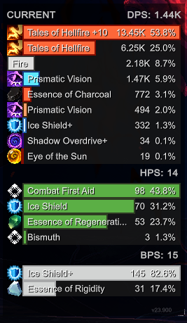
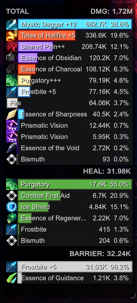
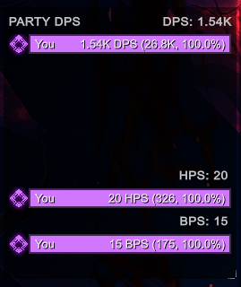
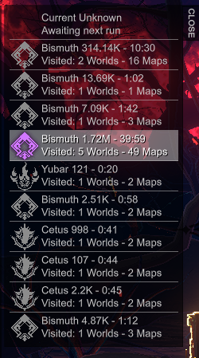
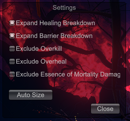

# Shape of Dreams DPS Meter

A client-side combat meter for **Shape of Dreams**. It tracks damage, healing, and barrier contribution during a run, with separate views for individual and party performance.

The compiled mod is available for players who want to install it directly. The C# source is also published so anyone can inspect it or build it themselves.

## Download

**[Download DPS Meter v1.0.0 (precompiled ZIP)](https://github.com/Doobyy/Shape-of-Dreams-DPS-Meter/raw/refs/heads/main/release/V1.0.0/DPSMeter-1.0.0.zip)**

The ZIP contains the ready-to-install `DPSMeter` mod folder. You do not need to compile the source to use this version.

## Install the precompiled mod

1. Download `DPSMeter-1.0.0.zip` from the link above.
2. Extract the ZIP. It should contain a folder named `DPSMeter`, with `DPSMeter.dll` and an `about` folder inside it.
3. Open your **Shape of Dreams game installation folder**.
4. Copy the entire extracted `DPSMeter` folder into the game's `mods` folder. Create a folder named `mods` if it does not already exist.
5. Confirm the files are arranged like this:

   ```text
   Shape of Dreams/
   └── mods/
       └── DPSMeter/
           ├── DPSMeter.dll
           └── about/
               ├── metadata.json
               └── description.txt
   ```

   The important detail is that `DPSMeter.dll` is directly inside `mods/DPSMeter/`—not loose in `mods/` and not nested inside an extra `DPSMeter/DPSMeter/` folder.

6. Launch the game.

To update later, close the game and replace the existing `mods/DPSMeter` folder with the folder from the newer release ZIP.

## Features

- **Damage tracking:** current DPS and total damage, with breakdowns by skill and Essence.
- **Healing and barriers:** healing-per-second (HPS), barrier-per-second (BPS), totals, and source breakdowns.
- **Party comparison:** compare player contributions in DPS and total views, including each player's share of the total.
- **Run history:** retain recent run summaries, including character, outcome, run duration, and visited-world/map information.
- **Display filters:** optionally exclude overkill damage, overhealing, or damage attributed to Essence of Mortality from displayed calculations. These filters affect displayed totals while preserving underlying run data so totals can be recalculated when a filter changes.
- **Configurable overlay:** move the meter and settings window, choose which metrics to display, and use the context menu to open settings, reload the mod, or open run history.

## Screenshots

<table>
  <tr>
    <th align="center">Current DPS</th>
    <th align="center">Total Damage</th>
    <th align="center">Party DPS</th>
  </tr>
  <tr>
    <td align="center" valign="top"></td>
    <td align="center" valign="top"></td>
    <td align="center" valign="top"></td>
  </tr>
</table>

<table>
  <tr>
    <th align="center">Run History</th>
    <th align="center">Settings</th>
  </tr>
  <tr>
    <td align="center" valign="top"></td>
    <td align="center" valign="top"></td>
  </tr>
</table>

## Build from source

### Requirements

- Windows and Visual Studio/MSBuild capable of building **.NET Framework 4.8.1** projects.
- A local installation of Shape of Dreams, for the game's managed assemblies referenced by the project.

### Build

1. Clone or download this repository.
2. Open `DPSMeter.csproj` in Visual Studio.
3. If the game is installed somewhere other than the default path, update the `ShapeOfDreamsHome` MSBuild property to point to its installation directory.
4. Select **Release** and build the project.
5. The compiled assembly is written to `bin/Release/DPSMeter.dll`.

The project references game-managed assemblies from `Shape of Dreams_Data/Managed`. Those game files are not included in this repository.

## Attribution approach

The meter observes the game's client-side combat events and uses the game's actor/skill relationships to attribute effects to their sources. It is intended to report combat activity; it does not replace or modify the game's damage calculations.

## Repository contents

- `src/` — C# source code.
- `about/` — mod metadata and in-game description used by the project.
- `release/V1.0.0/DPSMeter/` — the compiled v1.0.0 mod package.
- `release/V1.0.0/DPSMeter-1.0.0.zip` — ready-to-install ZIP archive.
- `images/` — screenshots.
- `DPSMeter.csproj` — project and game-reference configuration.

## Notes

This is a community mod. The published source is available for transparency and independent inspection; the downloadable ZIP contains the compiled release.

If you'd like to support the project, you're welcome to:

<a href="https://ko-fi.com/dooby0530"></a>
